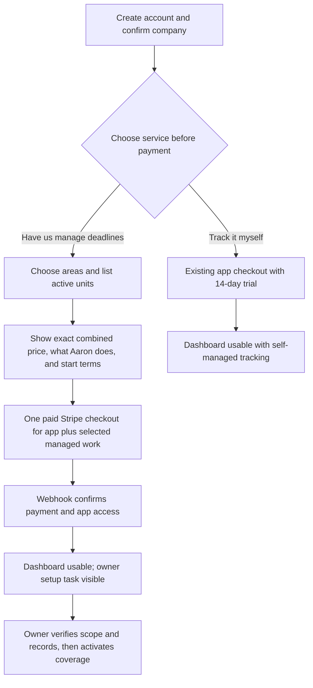
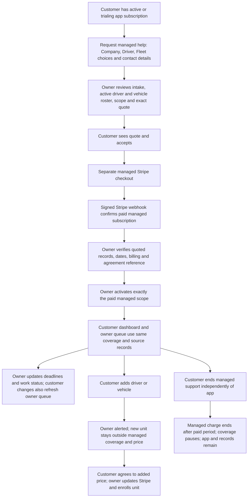

# Managed support: release map and execution plan

Status: staging branch `managed-service-staging-20261030` on November 16, 2026. Managed support has **not** been released to production. The current release gates below supersede the dated investigation further down this document.

### Current release gates (November 16)

| Gate | Current evidence | Next verification |
| --- | --- | --- |
| $10 managed Driver price | Deployed to staging functions and preview; pricing, fresh quote, and Stripe Sandbox checkout all show $10. All 74 function tests, app type check, and web export pass on this branch. | Confirm a new managed Driver unit change with a consenting pilot if that scope is selected. |
| New customer setup | Fresh Company + one Driver + one truck quote and Stripe Sandbox checkout passed at $51/month combined ($3 app + $48 managed); owner reconciled quoted units, saved setup draft, and activated coverage; customer dashboard and Settings both show active coverage and matching billing | Cancellation endpoints and customer display after year-two transition |
| Unit changes | Truck addition and removal previously matched Stripe Sandbox and customer/owner views; an approved $1 trailer addition on the fresh account appears in owner work and customer Settings at $49 managed + $3 app = $52/month; Stripe Sandbox previews the next invoice for $52 with six matching line items | Test managed Driver, second unit, duplicate action, and inactive-unit reconciliation |
| Billing transitions | Monthly Sandbox renewals through October 2027 were Paid at $52. The November 6, 2027 anniversary invoice was Paid at $44 after managed Company changed from $37 to $29. Managed-only cancellation passed its paid-period boundary and left the $3 app plan active. All-services cancellation passed its paid-period boundary, paused managed coverage, closed app access, and preserved records. All 74 function tests pass. | Smoke-test existing subscriber access with managed support switched off after production deployment. |
| Alerts and operations | Owner work queue shows due items. A real November 6 staging trailer addition generated `mail/managed_new_unit_fWgKmJi2K8NqohvYEbmLoB1XP7t1_CTrv8E6aq96Y9nlySdTo_d75228af1049319e1f285c75` to the owner with correct no-auto-enrollment wording. Production Trigger Email from Firestore delivered a separate November 6 test message to the owner inbox | Staging has no email extension, so generated managed-alert delivery is not proven end to end. Confirm a production managed alert during a consenting pilot and reconcile paid-awaiting-start requests daily |
| Compliance and devices | Owner/customer date and history parity, eligible quarterly IFTA completion and rollback, and a real staging reminder received on a spare Android phone passed. Android Company, Driver, Fleet, and Settings opened with the correct managed scope. The registered iPhone installed the internal staging build; Company and Driver were self-managed, Fleet managed, Settings opened, and the restored Fleet date matched. | Smoke-test existing subscriber access after the production deployment with managed support switched off. |
| Production | No managed release yet | Review and commit staging diff, deploy rules/functions/web in order, then one consenting live pilot |

The sections below preserve earlier investigation and may describe superseded designs. This current gate table controls release status.

**November 9 all-services end after coverage activation:** The staging customer `edscdelivery@gmail.com` at carrier `OnMWKGKiUNdhVJzcfkA41eSPbLj1` had an active $39/month combined Sandbox subscription (`sub_1UYZtLDF9fk7yI4RCoQzwBnI`) and active Company, Driver, and Fleet managed coverage. The customer used Settings to schedule both app and managed support to end December 5, 2026. Settings showed $2 app plus $37 managed and the same end date for both. Stripe Sandbox displayed `Cancels Dec 5, 2026` and no further invoice. Its Run simulation advanced to December 6, 2026 at 20:02 UTC. Stripe then showed `Canceled`. Staging Firestore showed app billing `canceled`, managed billing `canceled`, managed coverage `paused`, and managed request `ended` with `endAllServices: true`. The carrier document still existed with company name `eds`, and all ten Company compliance documents remained. The customer refreshed the staging dashboard and confirmed it now requires a subscription. Owner queue display after this particular transition still needs visual confirmation.

**November 9 all-services paid-period end:** The customer signed up as `big@big.com` in staging with a Company-only managed quote. The app showed $2 app + $37 managed = $39/month, both services scheduled to end December 9, 2026. Stripe Sandbox subscription `sub_1UZvS9DF9fk7yI4R51VJUVpX` initially showed `active`, `cancel_at` equal to December 9 at 8:29:52 AM Pacific, and no further invoice. Firebase matched: carrier billing `active` at $2, managed billing `active` at $37 with the same end date, and request `endAllServices: true`. Stripe's Run simulation advanced this subscription to December 9 at 4:35 PM UTC, past the end. Stripe now reports `canceled`, `ended_at` at the scheduled time, and test clock `clock_1UZvYaDF9fk7yI4RhqvemHMn`. The webhook updated staging carrier billing to `canceled`, managed billing to `canceled`, and the managed request to `ended`. The customer reported that the dashboard disappeared and the account reached the subscribe-again page; this confirms the customer access gate. This account had no `managedServiceCoverage` document because the owner never started coverage. Owner-screen verification is not yet separately observed.

**November 6 managed-only paid-period end:** The customer for staging carrier `fWgKmJi2K8NqohvYEbmLoB1XP7t1` used Settings to schedule managed support to end December 6, 2027. Before the transition, Settings showed app access Active at $3/month and managed support Ending at period end at $41/month, total $44/month. Stripe Sandbox showed the next invoice would be $3 with four managed products removed. Test clock `clock_1UYviqDF9fk7yI4RWB69vaUA` then advanced to December 7, 2027 and returned Ready. Stripe subscription `sub_1UYvGfDF9fk7yI4Rwr6LzRuE` remained Active with only the $2 company app and $1 app Driver items. Staging `managedServiceBilling` now reads $0 and `ended`; `managedServiceCoverage` reads `paused`; `managedServiceRequests` reads `ended`. Customer Settings shows Self-managed app access Active at $3, and Managed support Not active. This validates the actual paid-period boundary and preserves app access. A separate all-services billing boundary was subsequently tested on November 9, as recorded above.

**November 6 renewed-state and alert audit:** On staging, carrier `fWgKmJi2K8NqohvYEbmLoB1XP7t1` has `managedServiceBilling.monthlyAmountCents: 4100`, `status: active`, and no scheduled cancellation after the Stripe Sandbox anniversary renewal at $44 combined. Its carrier billing record has `monthlyAmountCents: 300`, `status: active`, `currentPeriodEnd` December 6, 2027, and the same subscription ID. The two stored amounts reconcile to Stripe's $44 paid renewal. A customer action adding `QA-TRAILER-1106` created a staging `mail` document at 2:27 PM on November 6, addressed to `aaron@weheartpaperwork.com`, with subject “Managed customer added a trailer: eds new.” Its text correctly says the unit is outside paid managed scope until the customer confirms the extra price. This proves generation, not delivery, because staging has no email extension. The production extension's separate test mail was delivered and confirmed by the owner. The older all-service cancellation subscription `sub_1UYD3bDF9fk7yI4REKcG7n1E` and combined test `sub_1UY7X1DF9fk7yI4RtMG5E0Pk` show early cancellation in Stripe after test-account deletion, so neither is valid evidence of behavior at the scheduled paid-period end. Two additional focused tests now check the actual state changes after a combined plan becomes app-only or fully canceled: app-only leaves app billing active and sets managed billing to ended with owner coverage paused; full cancellation marks both billing records canceled and pauses coverage. All 65 function tests pass. These are mocked transition checks; a real Stripe Sandbox clock transition remains required.

**November 6 fresh checkout, activation, and owner sign-in:** A new staging customer `edscdelivery+managed10@gmail.com` accepted a quote for Company, one Driver, and one truck. The quote showed $48/month managed in year one, $40/month afterward, $3/month app, and $0 one-time. Stripe Sandbox used a `cs_test_` session and showed one $51/month subscription with separate $2 app base, $1 app Driver, $37 managed Company, $10 managed Driver, and $1 managed truck items. Checkout returned to the staging Payment received page. The owner queue showed the same paid request and that checkout had added the quoted driver and truck. The owner saved a draft with all three areas, then started coverage. The owner form shows active status and a 2027-11-06 first-year anniversary. After a fresh customer-page reload, the dashboard showed Company, Driver, and Fleet managed since 2026-11-06; Settings showed Active managed support, $3/month app, $48/month managed, and $51/month combined. Activation did not initiate another checkout. A trailer was deliberately left off the quote for a later $1/month owner-approved addition test. The owner page now displays the signed-in email when access is denied and provides a switch-account action that preserves the owner destination through login. In the published staging preview, switching away from the customer account and signing in as `voice18@gmail.com` returned directly to Managed tracking and exposed the paid request.

**November 6 approved trailer addition:** The same customer added fictional trailer `QA-TRAILER-1106` in the staging Fleet tab. Before owner approval, the app said the trailer was tracked but outside paid managed coverage. The owner Needs information list showed the trailer and the $1/month proposed managed charge. The customer explicitly approved this Stripe Sandbox $1/month test in Codex chat, which the owner action recorded. The owner action then reported the trailer enrolled and the $1 charge added for the next billing cycle with no midcycle charge. The owner work list gained the trailer's inspection and registration requirements. After reloading the customer page, Settings showed $49/month managed and $52/month combined, while app access stayed $3/month. Stripe Sandbox independently showed a $52 next-invoice preview for December 6, itemized as $2 app base, $1 app Driver, $37 managed Company, $10 managed Driver, $1 managed truck, and $1 managed trailer. The already-paid first invoice remained $51. The subscription has a scheduled Company price change from $37 to $29 on November 6, 2027; actual execution of that phase is not yet tested.

**November 6 renewal simulation:** Stripe Sandbox advanced the fresh account's test clock to February 7, 2027. The December 6, January 6, and February 6 renewal invoices were created and marked Paid at $52; the original November 6 $51 invoice remained Paid. Stripe's next invoice preview is March 6, 2027 at $52. All four `invoice.paid` events appear in Stripe's successful-delivery filter with zero pending webhooks. This verifies repeated recurring collection and Stripe event delivery after the trailer addition. It does not independently verify the app's persisted renewal state, the November 2027 Company price transition, or any cancellation at period end.

**Further simulation:** Stripe subsequently completed the March through October 2027 cycles. Each renewal invoice is marked Paid at $52. At the October 7 simulation point, Stripe previews the November 6 anniversary invoice at $44, with managed Company reduced from $37 to $29 and the other five items unchanged. The actual November invoice and post-transition app state remain unverified. In the production Firebase Console, signed in as `attig.aaron@gmail.com`, Trigger Email from Firestore version 0.2.10 is installed against the default `us-west1` database and `mail` collection. Its SMTP URI uses `aaron@weheartpaperwork.com` and Gmail. The historical `owner_email_test_1789275122316` document shows `delivery.state: SUCCESS`, one attempt, `error: null`, `accepted: [aaron@weheartpaperwork.com]`, and SMTP response `250 2.0.0 OK` on September 12, 2026. This proves prior SMTP acceptance, not current inbox arrival or managed-alert end-to-end delivery. The Firebase Console warns Extensions will shut down March 31, 2027, so a migration to a self-managed email function must be planned.

**November 6 current email check:** A new production `mail/owner_email_check_20261106` document sent one clearly labeled operational test to `aaron@weheartpaperwork.com`. The extension recorded one attempt, `delivery.state: SUCCESS`, `error: null`, the owner address in `accepted`, and Gmail SMTP response `250 2.0.0 OK` at 3:33 PM Pacific. This verifies the live Firestore-to-SMTP path now. Inbox arrival and the specific managed-alert generator remain separate checks.

**November 6 anniversary execution:** Stripe Sandbox test clock `clock_1UYviqDF9fk7yI4RWB69vaUA` advanced to November 7, 2027 and returned `status: ready`. The associated subscription `sub_1UYvGfDF9fk7yI4Rwr6LzRuE` remains Active. Its November 6 renewal invoice `QI3VFC6M-0013` is marked Paid at $44. The current managed Company item is $29/month for November 6 to December 6, rather than the first-year $37. The $2 app base, $1 app Driver, $10 managed Driver, $1 managed truck, and $1 managed trailer remain on the subscription. This proves the scheduled Stripe price change executed; the customer app's persisted post-transition display still needs verification. The owner confirmed the November 6 production test email arrived in the inbox.

**November 6 driver price revision:** The managed Driver rate is now $10 per active driver per month in staging, added to the app's $1 driver charge. Pricing, quote generation, Stripe checkout line items, and owner-added unit billing share the same rate definition; two customer-facing reminders now read it from that definition. Existing paid Stripe subscriptions retain their prior $13 line items. An uncompleted $13 quote is rejected at acceptance or checkout and must be withdrawn and replaced with a fresh quote. The $10 checkout and year-two transition still need end-to-end Sandbox verification. The staging functions and preview hosting were deployed on November 6; the public staging pricing page visibly shows $10. App and function TypeScript builds, staging web export, and 63 function tests passed. The staging project has no email extension, so queued owner emails cannot be tested for delivery there; verify production extension and mail flow before release.

**November 6 owner work view:** The company queue still selects which company to open, but opening a company now shows every open requirement within its active managed scope, regardless of the queue filter. An at-a-glance count shows overdue, due soon, needs-information, and waiting items. Company, Driver, and Fleet sections are visible when selected, with explicit empty messages when no active managed unit exists. Each requirement is a compact row ordered by urgency; the owner expands a row to update a verified date or log work. The staging web preview was published and visually checked in the owner account: `eds` showed 10 requirements, including 1 overdue and 6 needing information, and explicit empty Driver and Fleet sections. This is an owner-view change only; it does not expand a customer's paid scope. A second staging owner check on DEMO 02 · Columbia Freight showed 17 requirements grouped across Company, Driver, and Fleet, including a CDL due in 18 days and a truck inspection due in 2 days.

**November 6 inactive-unit work:** A customer marking an enrolled driver, truck, or trailer inactive now creates an owner alert and an urgent queue item. The owner can reduce the matching managed recurring item in the active Stripe subscription and both remaining standard schedule phases without proration; only after Stripe verifies does the unit leave the paid managed roster. The customer removal confirmation says the charge remains until this action succeeds. Permanent deletion of an enrolled unit is blocked by the app callable and Firestore rules. Activation now derives its acceptance reference from the accepted quote ID and timestamp, and an audited owner action can correct older email-only references. Local app and function TypeScript builds, web export, and seven focused billing tests passed. The new rules, functions, and web preview were deployed to staging only. The two owner queue read functions were initially omitted from that deployment; they were deployed to staging on November 6. A refreshed owner queue then showed 16 items needing information instead of 15, and `eds` showed 7 instead of 6. The synthetic truck `QA-TRUCK-1105` was marked Sold or Removed and remains saved with zero active trucks. The user reported that the owner action history now shows `unit removed` at 8:19:26 AM on November 6, and the truck no longer appears in the needs-information queue. The refreshed staging customer Settings now shows $2 app + $37 managed = $39/month, down from $40 with the truck. Stripe Sandbox independently previews the next invoice on December 5 at $39, with $2 app plus $37 managed Company and no truck line. A read-only schedule check shows the Company price changing to $29 in November 2027 and `end_behavior: release`; the actual phase transition still needs a test-clock run. The Stripe dashboard's “Auto-cancels Feb 3, 2027” label for this November 5 Sandbox subscription is explained by Stripe's automatic 90-day cancellation of test subscriptions. It is not an app-scheduled cancellation: the subscription API reports `cancel_at: null` and `cancel_at_period_end: false`, and the schedule ends with `end_behavior: release`. Stripe says live subscriptions are not subject to this Sandbox retention rule. This label is not a production billing blocker. For longer-lived staging tests, use Stripe Dashboard → subscription Actions → Exclude from auto-cancellation (subject to Stripe's exemption limit). Source: https://support.stripe.com/questions/data-retention-policy-for-test-subscriptions. The scheduled Company price transition still needs a controlled test. Managed-only subscriptions with the final recurring unit require an explicit service-end flow rather than an empty Stripe subscription.

**November 5 added-unit update:** The owner action for an added unit in an already selected managed area updates the active Stripe subscription and remaining standard schedule phases without proration, verifies the new quantity, and enrolls that unit only after billing succeeds. The unit stays self-managed if any prerequisite fails. The first truck addition passed a real Stripe Sandbox test, including customer and owner views and the next-invoice preview. Further gates: driver and trailer additions, second unit quantities, duplicate actions, inactive units, and removal/inactivation billing reductions. A unit in a previously unselected area requires a separate scope quote. This code is staging-only; production is unchanged.

**November 5 test setup check:** The user deleted the older `edscdelivery@gmail.com` staging account and reused its address for a new one. The new account accepted an all-area, zero-unit quote at $37/month managed plus $2/month app and completed one `cs_test_` Stripe Sandbox checkout. Owner requests showed `paid_awaiting_start` and all three areas. The customer and owner views showed matching $39 first-year totals. The zero-unit copy was corrected locally to explain later owner-approved per-unit additions; TypeScript passed. The correction has not yet been published to staging.

**November 5 activation and first truck:** The customer started coverage through the staging owner form. The owner queue includes eds as the eighth active company. The agreement-reference field contains only `attig.aaron@gmail.com`, which does not identify an accepted agreement; require a real agreement reference and a correction path before production. A synthetic truck `QA-TRUCK-1105` was added from the customer Fleet tab. It initially remained outside managed support and the total stayed at $39. The owner work panel showed +$1/month starting next billing cycle. After explicit user approval for this Sandbox change, the owner recorded that approval and used the update-and-enroll action once. The customer Fleet tab changed to managed; Settings changed to $2 app + $38 managed = $40. Stripe Sandbox shows one $1 managed-truck item, the original $39 invoice unchanged, and a $40 invoice preview for December 5 with no midcycle charge. The owner action rewrote and verified the remaining Stripe phases, but a year-two transition is still untested.

**Renewal metadata correction:** The first-year-to-year-two Stripe phase previously used `serviceKind: managed` even for a combined app-and-managed subscription. Its future metadata now retains the actual subscription service kind and carrier ID. The unit update also repairs those fields when rewriting an existing future phase. This prevents the year-two transition from silently losing the combined app billing classification. The phase transition itself still needs a Stripe Sandbox test clock or anniversary test before production.

## November 3 staging update

The implementation and status tables below were written before the combined-checkout work and are historical. Current staging now has the first-time service choice, an instant standard managed quote, one app-plus-managed Stripe checkout with no trial, signed-webhook processing, separate app/managed amounts, explicit managed-only and all-service cancellation actions, and an app-only future phase when managed support ends. A returning app customer still uses the existing separate managed request and checkout. TypeScript, web export, and 52 function tests passed; the changed functions and web preview were deployed only to `weheartpaperwork-staging`.

The next release gate is a **fresh Stripe test-mode checkout** through the published preview. Check the displayed total, `cs_test_` checkout, signed-webhook state, app access, owner setup queue, selected roster, activation with a test agreement, and both cancellation choices. Also test renewal, unit changes and the first-year Company price transition before production. No real managed-service payment should be taken until those checks pass. The old statements below that describe the combined flow as unbuilt no longer reflect the code, but they remain useful as a test checklist.

**November 4 test evidence:** A customer completed a `cs_test_` Sandbox checkout and reported that the quote and Stripe totals matched. The customer page shows “Payment received” and setup pending. Staging webhook logs show successful `invoice.paid`, `checkout.session.completed`, and subscription events, with active app billing at $3/month for one driver. Stripe originally returned the customer to the staging main hostname, which showed a Firebase 404 because the preview hostname was rejected by `checkoutReturnBaseUrl`. The customer reached the paid state by opening the preview directly. The return-origin helper now permits only the staging preview hostname pattern in staging, and its focused tests pass; `createCheckoutSession` was redeployed to staging. The existing completed checkout cannot be replayed to prove the new return URL. Owner queue, coverage activation, cancellation and renewal remain to be verified.

**Owner request check:** In a separate owner session, the paid request is visible with one quoted driver and one truck. The paid checkout already added both missing unit records. Managed support is $51/month in year one ($37 Company + $13 Driver + $1 truck), then $43/month; app access is $3/month for the base and one active driver, making the combined totals $54 and $46 respectively with unchanged units. The owner screen now shows this split and clears stale request data if the browser switches from owner to customer authentication. The account is still `paid_awaiting_start`; it has not passed agreement review or been activated.

**Owner setup draft check:** The owner opened paid company setup, confirmed all three areas were selected, and saved a setup draft. This did not start coverage. The sample account has no written customer agreement reference, so do not activate it merely to finish a test. Remaining Stripe test gates include managed-only cancellation preserving the app, all-service cancellation, first renewal, year-two Company price, and unit quantity changes.

**Managed-only cancellation check:** The customer scheduled managed support to end on December 4, 2026. After refresh, Settings showed managed support “Ending at period end,” the $51 managed charge and $54 combined amount for the current period, and the app subscription still Active at an estimated $3/month. The separate “End managed support only” action disappeared while “End all services” remained available. The owner request showed “Managed billing ending at paid period end · app access continues”; the paid setup action is gated off for this status. The staging cancellation function logged an authenticated invocation without a new error. The customer and owner wording now labels the combined amount as current, shows the estimated $3 app amount after managed support ends, and labels the quote as historical. TypeScript and web export passed, and these wording changes were published to the staging preview. The actual Stripe phase transition on December 4 remains unverified.

**All-services cancellation check:** A second staging customer completed a Company-only Sandbox checkout for $39/month ($2 app + $37 managed) and reported a successful return. Settings then showed both the app subscription and managed support ending December 4, 2026. It also showed an incorrect future $2 app-only price and still offered “End all services.” Stripe can set `cancel_at` while leaving `cancel_at_period_end` false for a scheduled subscription; the UI had relied on the latter flag alone. Settings now recognizes either cancellation signal, shows that both services are ending, removes the app-only future price and duplicate end action, and keeps the current $39 total labeled as current. TypeScript and web export passed; the correction was deployed only to the staging preview. The actual December 4 cancellation and owner-side state for this second account are not yet verified.

**Owner cancellation label check:** The owner queue was loaded in Chrome and showed the Company-only paid request, but its generic `end_scheduled` label said “app access continues” even though customer Settings showed app access ending. The list function now derives `appEndScheduled` from the carrier's billing cancellation date, and the owner UI shows “App access and managed billing ending at paid period end” when both are scheduled. The all-services function also records the broader cancellation even when a managed-only end was scheduled earlier. TypeScript, function build, and staging web export passed; only the three changed staging functions and preview hosting were deployed. A fresh owner-page refresh is still needed to visually confirm the new label on the existing test account.

**Owner deep-link check:** A signed-out visit to `/owner-managed` redirected to login, and login then sent the owner to the customer dashboard. The login screen accepted `returnTo` only for `/review`. The staging web preview now preserves and accepts the exact `/owner-managed` return path through login, while keeping the destination allowlist narrow. TypeScript and staging web export passed; the published preview still needs a browser sign-in test to confirm the full redirect sequence.

**November 5 follow-up:** The first owner deep-link fix failed in Chrome: the login URL lost its `returnTo` parameter and sign-in still reached `/dashboard`. The revised staging preview saves only the owner destination in tab-scoped session storage before redirecting, and both the login action and root auth router consume it after sign-in. This guards against competing redirects dropping the URL parameter. TypeScript and web export passed, and the revised preview was published to the same staging channel. A fresh owner sign-in remains the required end-to-end check; do not count the earlier browser result as a pass.

**Owner queue verified:** After the revised staging deployment, the owner opened Managed tracking and refreshed Customer requests. The Company-only `eds` request displayed “App access and managed billing ending at paid period end,” showed the original $39 signup total as historical, and no longer projected an app-only renewal after both services end. This confirms the owner display agrees with the customer cancellation screen. The user reached the owner page after sign-in, but the exact automatic login return sequence was not separately observed by the assistant; retain that route as a distinct browser check if it matters for release.

## 1. The offer we are implementing

The customer retains a separate We Heart Paperwork app subscription and chooses which of Company, Driver, and Fleet deadlines Aaron will help manage. The customer completes filings and pays filing fees; managed support prepares instructions, follows up, and tracks the agreed deadlines. Only active drivers and vehicles included in the accepted scope enter managed billing and coverage.

Current staging code prices as of November 6: Company $37/month for months 1–12, then $29/month; managed Driver $10 per active driver/month, **in addition to** the app's $1 per active driver/month; managed truck $1/month; managed trailer $1/month; Fleet-only onboarding $40 once; optional DQ-file setup $99 per file once. The app's $2/month base is separate.

**Company setup price settled:** The owner confirmed $96 is fine. The $37 first-year rate is $8/month above the $29 renewal rate for 12 months, so the first-year difference is $96. The customer page currently says $96. The separate DQ-file setup charge remains $99 per file.

**Trial rule settled:** A new self-managed customer keeps the existing 14-day app trial. A new customer who chooses managed support at signup does **not** receive a trial. Their one checkout shows the app charge and selected managed charges separately, displays the full amount due immediately and the recurring total, and starts paid billing only after successful checkout. This choice must be explicit before payment. The managed signup must not describe any part of the bundle as a free trial.

## 1A. New customer choosing managed help from the beginning

**Current behavior:** New customers confirm the company, finish notification setup, complete the app subscription checkout, and land on the dashboard. The web dashboard and Settings link to managed support. There is no managed-choice step in the new-account signup path. The managed request function also requires an active or trialing app subscription. Therefore the customer can request managed help immediately after app checkout, but cannot select it as part of the present signup sequence. The managed request page is web-only; native iOS and Android do not show this path.

**Decision after review:** A new customer must not face an app checkout followed by a second managed checkout. The first-time choice belongs **before payment**: **“Track it myself”** or **“Have We Heart Paperwork manage deadlines.”** The self-managed choice keeps the existing app checkout. The managed choice gathers the selected areas, active unit counts and needed details, shows one combined and exact app-plus-managed price, and takes the customer through **one checkout**. The quote must show the app and managed components separately even if Stripe collects them in one transaction. A standard fixed-price quote should be available immediately; unusual or uncertain requests should be held for owner review before checkout. The customer reaches a usable dashboard after the single checkout while Aaron completes setup. A returning customer must not be sent through the choice again.

The choice must be recorded on the customer account, not just in browser storage, so it stays completed across devices and sign-ins. If the customer leaves mid-intake, preserve their draft; do not create a subscription or managed coverage. The exact handling of dashboard access before checkout must remain consistent with the app's existing billing gate.

**If a new customer has no units yet:** An all-three-area request can produce a Company-only $37/month quote, with Driver and Fleet shown as selected but carrying $0 until active quoted units exist. A Driver-only or Fleet-only request with no active units cannot be quoted yet under current code; explain this and keep the request pending for follow-up. Do not invent units or bill for empty areas. When the customer adds units later, obtain approval and update billing before placing them into managed coverage.

**First-day acceptance tests:** From a fresh signup, see the choice before checkout; take the self-managed path through one app checkout; repeat with managed selected, remove one area and enter units; verify one combined price and one checkout; confirm that payment creates app access plus only the selected managed obligation and owner setup work. Test abandoned intake, failed payment, duplicate clicks, refresh and sign out/in. Confirm the native apps retain access without showing a purchase path that conflicts with their approved store flow.

**Billing redesign required:** The staging code currently assumes two Stripe subscriptions and two checkouts. Stripe supports multiple priced items on one subscription, which could put app and managed components into one checkout. The app and managed portions would then need separate entitlement, change, cancellation and reconciliation logic so ending managed help leaves app access intact. The trial rule is settled above: self-managed retains the 14-day trial; new managed signup is paid immediately through its single checkout. The Stripe test-mode scenarios must prove the exact initial amount, first renewal, year-two Company change, unit additions, and managed-only cancellation before production.

## 2. End-to-end map of the current staging build (not the approved target)

### Target new-customer path

This diagram is a **target**, not the implemented flow. The current staging diagram below documents the code we must replace or adapt.

**Payment boundary in current staging code:** `Start managed coverage` is an owner activation step after a matching paid quote. It does not open checkout or initiate a Stripe charge. The separate Stripe subscription starts at checkout, before owner activation. The browser return alone is not proof of payment; the webhook marks `paid_awaiting_start`. This payment architecture must change for the one-checkout first-time managed signup.

**Service-start rule to implement and test:** For an instant standard quote, validate the selected areas, active unit identifiers and counts before checkout; collect detailed dates in a guided setup after payment. A nonstandard or conflicting roster needs owner review before checkout. The quote should state that managed coverage begins only after payment and setup confirmation and give an expected start time; a reasonable initial target is the next business day after confirmed managed payment when the required information is complete. If a material setup problem appears after payment, contact the customer promptly with the missing information and a choice: continue once it is supplied or cancel and refund the managed portion of the charge. The app subscription and dashboard remain available either way. This must be an operational workflow with owner reminders for paid-but-not-active accounts, not just customer-facing wording. Also test what happens if app payment fails between checkout and activation.

## 3. State and responsibility

The following table describes the **current staging implementation**. For the target first-time managed signup, the request/quote steps move before the single app-plus-managed checkout. It is not acceptable to use this table as evidence that the target billing path works.

| Stage | Customer sees / does | Owner sees / does | System proof required |
| --- | --- | --- | --- |
| Request | Chooses areas, supplies best email, phone, text preference, and known units | Request inbox | Stored request revision and contact; owner notification |
| Quote | Reviews exact recurring and one-time prices; accepts or asks for change | Confirms roster, scope and prepared quote | Quote tied to request revision and active unit IDs |
| Checkout | Pays in Stripe for managed subscription | Waits for payment confirmation | Signed webhook sets quote and request to `paid_awaiting_start`; billing points to correct managed subscription |
| Setup | Sees setup in progress | Confirms paid units, dates, agreement reference, then starts coverage | Coverage matches quote; customer and owner see active state |
| Ongoing | Uses dashboard; can change source dates and add units | Works overdue / 30 / 90 day queue and records instructions | Both views reflect the same source dates and coverage; activity history exists |
| Added unit | Retains app access; requests added managed help if desired | Receives alert, gets consent, adjusts Stripe, enrolls unit | No automatic managed charge or coverage; Stripe quantity and all schedule phases match before enrollment |
| Cancellation | Ends managed support from Settings | Sees scheduled end and handles handoff | Managed subscription ends after paid period, coverage pauses, app subscription and records stay intact |

## 4. What exists and what is proven

| Area | Built in staging code | Proven so far | Still needed |
| --- | --- | --- | --- |
| Customer request, default selections, contact and intake | Yes | UI walkthrough and focused validation tests | Full real-customer intake and correction path |
| Owner quote and customer acceptance | Yes | Staging UI and focused pricing/roster tests | Verify exact displayed amount against Stripe line items and final price rule |
| Managed checkout and paid webhook | Yes | A staging test checkout was attempted and corrected to use a test key; return screen was reviewed | Record a complete fresh `cs_test_` checkout and verify Stripe, quote, request and billing records all agree |
| Owner activation and shared customer/owner coverage | Yes | Code checks matching payment, quote and units; UI reviewed | Activate a paid staging account with a genuine test agreement reference and verify both views and deadline edits |
| Added unit alert | Yes | Synthetic staging unit appeared in owner queue; alert document queued | Confirm actual email delivery and a real customer add on both platforms |
| Added unit paid enrollment | Yes, requires manual Stripe quantity and schedule changes | Validation code and an unpaid synthetic demonstration | End-to-end paid staging test: consent, Stripe update, next invoice, enrollment, both views |
| Adding a previously unselected managed area | Request and owner review exist | No completed billing transition | Design and test a separate scope-change quote/payment/activation path, or explicitly hold such requests for manual off-app handling |
| Customer cancellation | Yes | Staging cancellation flow tested after a fix; unit tests cover scheduling | Verify actual Stripe period end, webhook pause, customer wording and app access |
| Email notification delivery | Firestore `mail` writes exist | Production has email extension; staging test fixture showed delivery not reported | Test delivery and failure handling, including owner alert, paid checkout and cancellation |
| High-volume owner workflow | Queue filters and company drilldown exist | Sample companies and synthetic queue item reviewed | Test realistic volume, pagination/performance, deduplication, retries and daily reconciliation |

## 4A. Use-case and friction audit for the target

| Case | Intended customer experience | Status / remaining decision |
| --- | --- | --- |
| New self-managed customer | Choose self-managed, complete the existing 14-day app trial checkout, reach dashboard | Existing path works; new choice screen and one-time flag unbuilt |
| New managed customer with Company only | See $2 app plus $37 managed Company for year one ($39/month), no trial, one checkout; dashboard works while owner sets up | Combined checkout, webhook and entitlement redesign unbuilt |
| New managed customer with drivers and/or fleet | Enter active units before price confirmation; show app $1 per active driver, managed $13 per covered driver, $1 per covered truck/trailer and any one-time fees; pay once | Exact intake, quote and Stripe amount must match; automatic standard quote versus owner exception needs implementation |
| New customer selects an empty area | Show $0 for Driver/Fleet with zero active units; do not imply coverage for nonexistent units | Company plus empty areas is workable in current pricing; Driver-only or Fleet-only with zero units needs a clear no-charge path or hold |
| Customer leaves intake or checkout | Resume without duplicate request, checkout, subscription or charge | Unbuilt for target; needs persisted draft and idempotent checkout |
| Payment succeeds but return page fails | App and managed state update from signed webhook; customer can sign back in and see status | Current webhook is written for separate app/managed sessions; target routing unbuilt |
| Payment fails or needs authentication | No managed coverage; clear retry using the same quote without duplicate charge | Must test card decline, delayed payment and required authentication |
| Owner cannot start promptly after payment | Customer sees setup status; owner gets an overdue setup alert and contacts customer; customer may wait or receive managed-charge refund | Promised setup time, refund action and owner alert unbuilt |
| Existing self-managed customer requests managed later | Show full incremental price and explicit consent; use saved billing details when possible; avoid unnecessary re-entry | Upgrade billing path not designed. It may require payment authentication; cannot promise zero further steps |
| Self-managed customer still in trial upgrades to managed | Explain whether trial ends and exact amount due before confirmation | **Decision needed.** Recommended: end app trial when managed paid service starts; do not silently discard remaining trial days |
| Add driver/truck/trailer after activation | Alert owner; unit stays outside managed coverage until customer agrees, price is updated, and owner enrolls | Initial staging flow partly built against separate subscriptions; must be retested against combined billing |
| Inactivate or remove a covered unit | Agree when support stops, reduce managed and app quantities as appropriate, and preserve history | Managed quantity reduction and effective-date rule not built or proven |
| Change selected areas | Show exact revised price and scope; avoid immediate unexpected charge or loss of coverage | Existing active-scope request has no finished billing transition |
| End managed, keep app | Customer chooses End managed; managed items stop at the agreed paid-period end; app, records and reminders continue | Existing flow cancels a separate subscription. Target combined-subscription cancellation is unbuilt and needs period-end testing |
| End app or delete account while managed is active | Never leave managed billing running or orphan owner work; preserve required financial audit records | Must redesign and test with combined subscription and account deletion |
| App payment failure, refund or dispute | Clearly define whether managed work pauses, ends or continues and what the owner must do | Unresolved policy and reconciliation behavior |
| Year-one to year-two Company rate | Company changes from $37 to $29 after 12 paid months while app and unit counts remain correct | Existing managed-only schedule must be redesigned and tested with combined items and later unit changes |
| Referral reward on combined invoice | Apply rewards only to eligible direct qualifying payments; distinguish app and managed invoice lines | Current ledger filters app price IDs; combined-subscription webhook and reward classification need audit |
| iOS and Android users | Native apps show the correct access and coverage after web signup without a web-purchase prompt in the apps | Cross-platform entitlement and store-policy review required before native update |

**Friction still present:** The target removes the second checkout for a new managed customer. It does not yet settle how a later upgrade is charged, how much information is required before first checkout, or how quickly owner setup completes. Each must be tested with a real user task before calling the journey smooth.

### Cancellation contract and language

The app subscription is the foundation for **both** self-managed tracking and managed support. “Self-managed” is a way of using the app, not a second subscription that a managed customer can cancel while keeping managed support. The target one-checkout design may use one Stripe subscription with separate app and managed line items; service controls must remain distinct.

| Customer's action | Result at the stated effective date | Confirmation must say |
| --- | --- | --- |
| **End managed support** | Stop only managed work and managed charges. Keep app subscription, dashboard, records and reminders. Customer handles deadlines after handoff. | Exact end date, new app-only amount, which areas return to self-management, and that nothing is deleted. |
| **Cancel app subscription** (self-managed customer) | End app access at the stated date, subject to existing account/data policy. | Exact end date, access consequence, and how records can be retained/exported. |
| **End all services** (customer with managed support) | End both app access and managed support at the stated date. | Exact end date, both charges ending, support handoff, and access/data consequences. Never suggest the app can be canceled while managed help continues. |
| **Delete account** | Separate permanent account-deletion flow with its own confirmation and billing cleanup. | This is more than ending a subscription and has permanent data consequences. |

The Settings screen must show **App access** and **Managed support** as two service cards with their own amount and status. Do not label every customer's app plan “Self-managed app access” after managed coverage starts. Do not expose a generic Stripe portal cancellation control that can cancel the whole combined subscription when the customer intended to end managed help only. Use explicit in-app actions and a confirmation showing the remaining amount before any change. A later renewal or pending payment must not override a scheduled managed-only end. This is an implementation and test requirement, not current behavior.

## 5. Release gates in order

1. **Freeze the one-checkout design and commercial rule.** $96 Company first-year difference and no trial for a new managed signup are settled. Decide the instant standard quote inputs, the promised setup timeframe, and exactly how a previously unselected managed area is quoted and activated. Confirm the service agreement and cancellation language. Make the price card, quote, Stripe items and receipt agree. Rework the existing two-subscription assumptions before any production billing test.
2. **Prove one complete paid staging account.** Use a dedicated staging customer and Stripe test mode. Request all three areas with one driver, truck and trailer; verify quote, customer acceptance, `cs_test_` checkout, signed webhook, paid state, owner unit setup, agreement reference, activation, customer dashboard and owner queue. Capture expected and actual amount at each point. A demo carrier with fake coverage does not satisfy this gate.
3. **Prove every boundary case.** Test Company only, Driver only, Fleet only, no active units, quote expiry, changed roster, duplicate checkout, declined payment, webhook retry, later upgrade from app trial, and cancellation before activation. Confirm no charge or coverage is silently added. Confirm unselected areas remain self-managed.
4. **Prove ongoing sync.** Change a due date from the customer dashboard and from the owner tool; verify the same date, countdown and work state in both views after refresh. Test a completed requirement, inactive/re-activated unit, and custom requirement. Verify history and no unrequested data changes.
5. **Prove added-unit and removal handling.** Add a customer driver and vehicle. Verify owner alert and unpaid exclusion. Obtain recorded consent; update test Stripe subscription without proration and all future schedule phases; verify the next-cycle amount; enroll once; verify duplicate clicks cannot double bill or duplicate coverage. Test removal/inactivation and decide how the managed charge is reduced. This last reduction rule is not yet proven.
6. **Prove cancellation and recovery.** Schedule cancellation, confirm no immediate app cancellation, check Stripe and Firestore at the period end, and verify the owner receives the event. Simulate a missed webhook or failed email and reconcile manually from Stripe. Define how to handle a paid subscription stuck in `paid_awaiting_start` and a Stripe quantity updated before enrollment fails.
   Separately test **End managed support**, **Cancel app subscription** for an app-only customer, **End all services** for a managed customer, and **Delete account**. Verify each action's confirmation, remaining charge, access and records.
7. **Release in a controlled order.** Review staging diff, build and run focused tests, deploy required Firestore rules/functions, then web hosting. Check a real production owner account can view the empty queue. Start with one consenting customer and compare actual Stripe charges, coverage and notifications daily through the first renewal. Publish mobile updates only if their UI or routes changed; review iOS and Android policy impact before submitting them.

## 6. Operating rules and stop points

- Never activate coverage from a redirect, an owner click, or an email alone. Require a matching paid Stripe subscription, quote, request revision, active units, and recorded agreement.
- New units are self-managed until the customer agrees to the incremental price and Stripe is updated; only then enroll the unit. Company rate remains fixed.
- Never manually change a Stripe quantity without recording the related company, unit, consent, effective date, expected next invoice and resulting coverage action. If the second step fails, stop and reconcile before continuing.
- Keep app access and managed support independently controllable even if one Stripe subscription contains both sets of items. Ending managed support must preserve app access, dates and records.
- Treat email as an alert, not the source of truth. Check the owner queue and Stripe directly if an alert is delayed or fails.
- Define an owner daily reconciliation: paid but not activated, active coverage with nonpayable billing, Stripe unit quantity versus covered unit IDs, ending subscriptions, and alert delivery failures. Any mismatch blocks further enrollment until corrected.
- Do not promise literal 100% uptime. The release standard is that every supported scenario passes, failures are visible, duplicate events are safe, and there is a documented recovery step before real customers use it.

## 7. Immediate next step

The one-checkout first-day path has since been implemented and tested in Stripe Sandbox. See the current gate table at the top of this document and `MANAGED_SERVICE_ISOLATION_AUDIT.md` for the remaining release checks. Record one evidence row per transition: customer screen, Firestore status, Stripe subscription or invoice, and owner screen.
